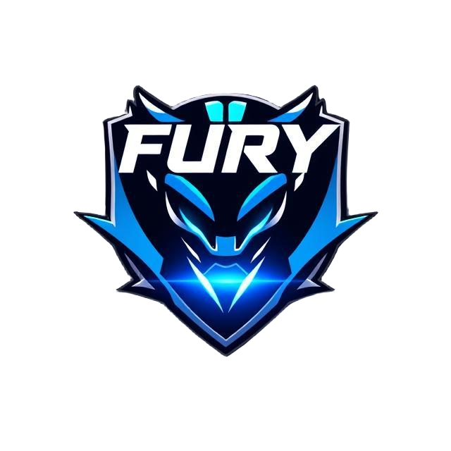

# Fury



Fury 200B for the official RLBot v5 botpack. A single bot, built from
[SubparN0va/GGLBot's CPU `bob` branch](https://github.com/SubparN0va/GGLBot/tree/bob).

Trained for 200 billion steps (~3.70 million hours / 423 years of game time).
Loves to do a lot of things, dribble, pass and bang the ball.

## Runtime

- Shared RLBot **CPU** PyTorch from `torch-archive`; no CUDA or bundled LibTorch.
- RocketSim v3 local ball prediction at 120 Hz, sampled at 0.5/1/1.5/2 seconds.
  Collision meshes are included. Missing v3 initialization is a startup error.
- 318 observations, 380 discrete actions, ReLU and LayerNorm.
  Shared head and policy.
- Deterministic inference, tick skip 8.
- Three CPU inference warm-up passes before connecting; their controls are discarded.
- Blue and orange teams, 1v1/2v2/3v3. One Fury per process, no bot selector.
- Agent ID `happybavarian07/fury`.

## Build

```sh
git clone --recurse-submodules https://github.com/HappyBavarian07/FuryBotpack.git
cd FuryBotpack
bob build bob.toml
bob split bob_build
```

Bob uses Linux Docker containers to build both Linux and Windows packages
against the same public CPU PyTorch archives as the botpack. It supplies
platform launch commands and copies the logo/loadout into the output.
Add the platform output folder to RLBot v5. The launcher locates the shared
`torch-archive` beside/above the package or in RLBot's standard user data folder.

For a native Windows build, initialize the Visual Studio x64 environment first:

```sh
cmake -S . -B build-rel -G Ninja -DCMAKE_BUILD_TYPE=Release
cmake --build build-rel --config Release -- -j 30
rlbot\GGLBot.exe --self-test
```

Rust 1.95+ and CMake 3.22+ are required. The native build defaults to
`%LOCALAPPDATA%/RLBot5/bots/torch-archive/torch`; override with
`-DLIBTORCH_ROOT=<path>` when needed. The Docker build installs Rust 1.95.0.

`--self-test` checks actual CPU model loading/inference for both teams in all
three modes, a v3 wall bounce, v5 flip availability, countdown controls, and
8/7 frame timing including duplicate and dropped packets. It does not launch
Rocket League or establish in-game playing strength.

## Provenance

Base: GGLBot `bob` commit `bb9178779f0012f4d340083a21df1bd840d32c4d`.
Fury observation builder, old action table, kickoff features, logo, loadout,
and checkpoint were prepared for this submission.
The v3 adapter retains its C API layout and trajectory sampling; the Rust
backend is a vendored snapshot with its original MIT license at
`inc/RocketSimV3/LICENSE`. The upstream C++ RocketSim submodule remains for
the GGL observation/state types; ball prediction runs through v3.

Checkpoint: **200,000,984,297 steps**. SHA-256:

| File | SHA-256 |
|---|---|
| `POLICY.lt` | `b6af2945b828a65b21ff3497664e59fbad734fb183b721f648811dbe4bdb8a99` |
| `SHARED_HEAD.lt` | `925ed4599acf66540a98da9f119e7cf723c7b3d9f04c36fb04b73239bbe324cf` |
